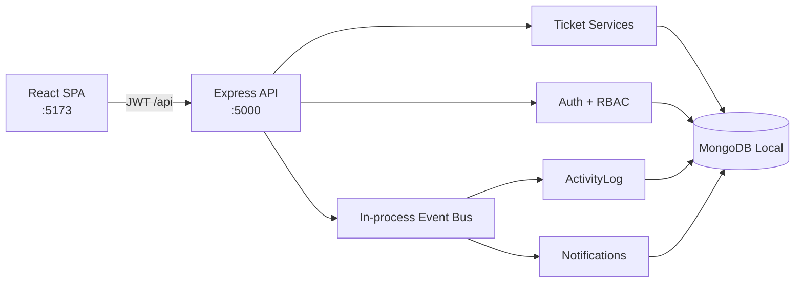

# Support Ticket Management System

A full-stack mini helpdesk that lets end users submit and track support tickets, while administrators triage status, priority, and conversations across all tickets.

## Project Overview

**Problem it solves:** Teams need a simple, role-aware support workflow without relying on email threads or spreadsheets. Users need visibility into their own requests; admins need a single queue to manage them.

**Main capabilities:**
- Authenticated user and admin portals
- Ticket lifecycle management (create, update, comment, resolve/close)
- In-app notifications and activity history
- Search, filter, sort, and paginated ticket lists
- Dashboard statistics derived from live MongoDB data

**Roles:**
| Role | Access |
|------|--------|
| `USER` | Own tickets, comments on own tickets (while open/in progress), own notifications, user dashboard |
| `ADMIN` | All tickets, status/priority updates, comments on any ticket, admin dashboard and notifications |

**Technology stack:**
- **Frontend:** React.js, Vite, JavaScript, Tailwind CSS, React Router, Axios, React Context, React Hot Toast, Lucide React
- **Backend:** Node.js, Express.js (ES Modules), MongoDB Local, Mongoose, JWT, bcryptjs, Zod
- **Tooling:** Nodemon, Oxlint, Postman collection under `docs/`

> Verified locally with Node.js `v24.x` and npm `v11.x`. Use **Node.js 18+** (LTS recommended).

---

## Features

Only features that exist in this repository are listed.

- Public registration and login (registration always creates `USER`)
- JWT authentication with protected API routes and SPA session restore
- Role-based authorization (`USER` / `ADMIN`)
- User ticket CRUD (edit/delete blocked for `RESOLVED` / `CLOSED`)
- Admin status transitions and priority updates
- Ticket comments (users restricted on resolved/closed; admins may still reply)
- Ticket activity timeline (retained after ticket deletion for audit)
- In-app notifications (scoped to the authenticated recipient)
- User dashboard with live ticket stats and recent items
- Admin dashboard with live global stats, recent tickets, and latest updates
- Server-side search, filtering, sorting, and pagination
- Dedicated statistics endpoints for efficient dashboard counts
- Graceful UI handling when a notification references a deleted ticket

---

## Architecture

### Frontend
- Vite SPA with React Router layouts: `AuthLayout`, `UserLayout`, `AdminLayout`
- Auth state in `AuthContext` (JWT + user in `localStorage`; `/auth/me` refresh on load)
- Route guards: `ProtectedRoute`, `AdminRoute`, `PublicOnlyRoute`
- Axios client attaches `Authorization: Bearer <token>` and clears session on `401`
- Feature pages under `src/pages/user` and `src/pages/admin`; API wrappers under `src/services`

### Backend
- Express app (`src/app.js`) mounts `/api` routes with CORS, JSON parsing, centralized error handling
- Layering: routes → controllers → services → Mongoose models
- Request validation via Zod (`validate` middleware); ObjectId params via `validateObjectId`
- Auth: `authenticate` (JWT + live user lookup) and `authorize(...roles)`

### Database
- Local MongoDB via Mongoose models: `User`, `Ticket`, `Comment`, `Notification`, `ActivityLog`
- Indexes on ownership, status/priority, and list sort fields

### Authentication flow
1. User registers or logs in → API returns JWT + sanitized user (no password)
2. Frontend stores token and sends it on subsequent requests
3. `authenticate` verifies JWT and loads the current user from MongoDB (deleted users are rejected)

### Authorization flow
- Ticket ownership enforced in user ticket services
- Admin ticket routes require `ADMIN`
- Comments/activity use shared ticket access rules (owner or admin)

### Event and notification flow
- Domain events emit on create/update/status/comment/delete
- Listeners write activity logs and recipient notifications
- Actors are excluded from their own notification fan-out
- Ticket deletion removes related comments/notifications but **retains** activity logs (with snapshot metadata)



---

## Project Structure

```text
support-ticket-management/
├── README.md
├── .gitignore
├── docs/
│   └── Support-Ticket-Management.postman_collection.json
├── .mongodb-data/                 # Local MongoDB data directory (gitignored)
├── backend/
│   ├── .env.example
│   ├── package.json
│   ├── scripts/                   # seed + integration tests
│   └── src/
│       ├── app.js
│       ├── server.js
│       ├── config/
│       ├── constants/
│       ├── controllers/
│       ├── events/
│       ├── middlewares/
│       ├── models/
│       ├── routes/
│       ├── services/
│       ├── utils/
│       └── validators/
└── frontend/
    ├── .env.example
    ├── package.json
    ├── vite.config.js
    ├── scripts/                   # UI contract tests
    └── src/
        ├── App.jsx
        ├── main.jsx
        ├── components/
        ├── context/
        ├── hooks/
        ├── layouts/
        ├── pages/
        ├── services/
        └── utils/
```

---

## Prerequisites

- **Node.js** 18+ (LTS recommended; project verified on Node 24)
- **npm** (comes with Node.js)
- **MongoDB Community Server** running locally on port `27017`
- **Git** (to clone the repository)

---

## Local Installation

Commands below assume PowerShell on Windows. Adjust the clone URL/path for your environment.

### 1. Clone repository

```powershell
git clone <repository-url>
cd support-ticket-management
```

### 2. Install backend dependencies

```powershell
cd backend
npm install
```

### 3. Install frontend dependencies

```powershell
cd ..\frontend
npm install
```

### 4. Configure environment variables

```powershell
# Backend
cd ..\backend
Copy-Item .env.example .env
# Edit .env: set JWT_SECRET (32+ chars) and admin seed values

# Frontend (optional; defaults work with Vite proxy)
cd ..\frontend
Copy-Item .env.example .env
```

### 5. Start MongoDB Local

Example using a project-local data directory:

```powershell
& "C:\Program Files\MongoDB\Server\9.0\bin\mongod.exe" `
  --dbpath "<absolute-path-to>\support-ticket-management\.mongodb-data" `
  --port 27017 `
  --bind_ip 127.0.0.1
```

Use your installed MongoDB `bin` path if it differs. Keep `MONGODB_URI` pointed at `127.0.0.1:27017`.

### 6. Seed the admin account

```powershell
cd backend
npm run seed:admin
```

Uses `ADMIN_NAME`, `ADMIN_EMAIL`, and `ADMIN_PASSWORD` from `backend/.env`.  
Public registration **cannot** create `ADMIN` accounts.

### 7. Start backend

```powershell
cd backend
npm run dev
```

- API base: `http://localhost:5000/api`
- Health: [http://localhost:5000/api/health](http://localhost:5000/api/health)

### 8. Start frontend

```powershell
cd frontend
npm run dev
```

- App: [http://localhost:5173](http://localhost:5173)
- Login: [http://localhost:5173/login](http://localhost:5173/login)
- User portal: `/app...`
- Admin portal: `/admin...` (ADMIN only)

### 9. Run tests

Backend (API server must be running for integration suites):

```powershell
cd backend
npm run validate:models
npm run test:regression
```

Frontend contract tests (API server must be running):

```powershell
cd frontend
npm run test:auth-ui
npm run test:user-tickets-ui
npm run build
```

---

## Environment Variables

### Backend (`backend/.env`)

| Variable | Required | Description |
|----------|----------|-------------|
| `MONGODB_URI` | **Yes** | Local MongoDB URI |
| `PORT` | **Yes** | API port (typically `5000`) |
| `JWT_SECRET` | **Yes** | Signing secret, **min 32 characters** |
| `NODE_ENV` | No | Defaults to `development` |
| `CORS_ORIGIN` | No | Defaults to `http://localhost:5173` |
| `JWT_EXPIRES_IN` | No | Defaults to `7d` |
| `ADMIN_NAME` | Seed only | Display name for `npm run seed:admin` |
| `ADMIN_EMAIL` | Seed only | Admin email for seed script |
| `ADMIN_PASSWORD` | Seed only | Admin password for seed script (min 8 chars) |

Templates: `backend/.env.example` (placeholders only — never commit real secrets).

### Frontend (`frontend/.env`)

| Variable | Required | Description |
|----------|----------|-------------|
| `VITE_API_BASE_URL` | No | Defaults to `/api` (Vite proxies to `http://localhost:5000`) |

Template: `frontend/.env.example`

---

## Admin Setup

1. Set `ADMIN_NAME`, `ADMIN_EMAIL`, and `ADMIN_PASSWORD` in `backend/.env`.
2. Ensure MongoDB is running.
3. Run:

```powershell
cd backend
npm run seed:admin
```

- If the admin already exists with role `ADMIN`, the script exits without changes.
- Login through the UI or `POST /api/auth/login` using the seeded email/password.
- Do **not** publish real admin credentials in documentation or source control.

---

## Testing

### Backend scripts (`backend/package.json`)

| Command | Purpose |
|---------|---------|
| `npm run validate:models` | Model/index validation against MongoDB |
| `npm run test:auth` | Auth + RBAC integration tests |
| `npm run test:tickets` | User ticket API tests |
| `npm run test:admin-tickets` | Admin ticket API tests |
| `npm run test:comments` | Comment API tests |
| `npm run test:events` | Events, activity, notifications |
| `npm run test:phase10` | Admin UI API contract checks |
| `npm run test:phase11` | Search/filter/sort/stats checks |
| `npm run test:regression` | Auth → tickets → admin → comments → events → phase10 → phase11 |
| `npm run test:phase4` … `test:phase7` | Cumulative suites through earlier phases |

### Frontend scripts (`frontend/package.json`)

| Command | Purpose |
|---------|---------|
| `npm run test:auth-ui` | Auth UI API contract tests |
| `npm run test:user-tickets-ui` | User ticket UI API contract tests |
| `npm run build` | Production build |
| `npm run lint` | Oxlint |

Most backend/frontend integration tests require the API on port `5000` and MongoDB Local.

---

## API Documentation

Base URL: `http://localhost:5000/api`

Common success envelope:

```json
{
  "success": true,
  "message": "...",
  "data": {}
}
```

Common error envelope:

```json
{
  "success": false,
  "message": "..."
}
```

Important status codes: `400` validation, `401` auth, `403` forbidden, `404` not found, `409` conflict, `500` server error.

List endpoints return pagination metadata:

```json
{
  "pagination": {
    "total": 0,
    "page": 1,
    "limit": 10,
    "totalPages": 0,
    "hasNextPage": false,
    "hasPrevPage": false
  }
}
```

### Health

| Method | URL | Auth | Role |
|--------|-----|------|------|
| `GET` | `/api/health` | No | — |

### Authentication

| Method | URL | Auth | Body |
|--------|-----|------|------|
| `POST` | `/api/auth/register` | No | `{ "name", "email", "password" }` (strict; no `role`) |
| `POST` | `/api/auth/login` | No | `{ "email", "password" }` |
| `GET` | `/api/auth/me` | Bearer | — |

Successful register/login `data`: `{ "token", "user" }` where `user` has `id`, `name`, `email`, `role` (never password).

### User tickets (`authenticate` required; ownership enforced)

| Method | URL | Notes |
|--------|-----|-------|
| `POST` | `/api/tickets` | Body: `title`, `description`, `category`, optional `priority` (`LOW\|MEDIUM\|HIGH\|URGENT`, default `MEDIUM`) |
| `GET` | `/api/tickets` | Query: `status`, `priority`, `search`, `page`, `limit` (1–100), `sortBy` (`createdAt\|updatedAt`), `sortOrder` (`asc\|desc`) |
| `GET` | `/api/tickets/stats` | User dashboard counts |
| `GET` | `/api/tickets/:id` | Own ticket only |
| `PATCH` | `/api/tickets/:id` | `title` / `description` / `category` / `priority` (not status); blocked when `RESOLVED`/`CLOSED` |
| `DELETE` | `/api/tickets/:id` | Blocked when `RESOLVED`/`CLOSED` |

### Admin tickets (`authenticate` + `ADMIN`)

| Method | URL | Notes |
|--------|-----|-------|
| `GET` | `/api/admin/check` | Confirms admin access |
| `GET` | `/api/admin/tickets` | Query: `status`, `priority`, `category`, `createdBy`, `search`, `page`, `limit`, `sortBy` (`createdAt\|updatedAt\|priority\|status`), `sortOrder` |
| `GET` | `/api/admin/tickets/stats` | Global dashboard counts |
| `GET` | `/api/admin/tickets/:id` | Any ticket + creator `name`/`email` |
| `PATCH` | `/api/admin/tickets/:id/status` | Body: `{ "status" }` — transitions validated; `CLOSED` is terminal |
| `PATCH` | `/api/admin/tickets/:id/priority` | Body: `{ "priority" }` |

Allowed status transitions:

| From | To |
|------|----|
| `OPEN` | `IN_PROGRESS`, `RESOLVED`, `CLOSED` |
| `IN_PROGRESS` | `OPEN`, `RESOLVED`, `CLOSED` |
| `RESOLVED` | `OPEN`, `IN_PROGRESS`, `CLOSED` |
| `CLOSED` | _(none)_ |

### Comments (`authenticate`; owner or admin)

| Method | URL | Notes |
|--------|-----|-------|
| `POST` | `/api/tickets/:id/comments` | Body: `{ "message" }` (1–2000 chars) |
| `GET` | `/api/tickets/:id/comments` | Query: `page`, `limit` (max 100) |

### Activity (`authenticate`; owner or admin; admins may view retained logs after delete)

| Method | URL | Notes |
|--------|-----|-------|
| `GET` | `/api/tickets/:id/activity` | Query: `page`, `limit` (max 100) |

### Notifications (`authenticate`; recipient-scoped)

| Method | URL | Notes |
|--------|-----|-------|
| `GET` | `/api/notifications` | Query: `page`, `limit`, optional `isRead` (`true`/`false`). Ticket payload includes availability for deleted tickets. |
| `PATCH` | `/api/notifications/:id/read` | Mark one as read |
| `PATCH` | `/api/notifications/read-all` | Mark all as read for current user |

### Statistics response examples

`GET /api/tickets/stats` → `data.stats`: `{ total, open, inProgress, resolved, closed }`

`GET /api/admin/tickets/stats` → `data.stats`: `{ total, open, inProgress, resolved, closed, high, urgent }`

---

## Postman Collection

Import:

[`docs/Support-Ticket-Management.postman_collection.json`](docs/Support-Ticket-Management.postman_collection.json)

Collection variables:
- `baseUrl` → `http://localhost:5000/api`
- `token` → set automatically by Login/Register test scripts when present
- `ticketId`, `notificationId` → set from create/list responses where scripted

---

## Frontend Routes

| Path | Audience |
|------|----------|
| `/login`, `/register` | Public |
| `/app`, `/app/tickets`, `/app/tickets/create`, `/app/tickets/:id`, `/app/notifications` | Authenticated USER (and technically any authenticated user via `ProtectedRoute`) |
| `/admin`, `/admin/tickets`, `/admin/tickets/:id`, `/admin/notifications` | `ADMIN` only (`AdminRoute`) |

Token storage: JWT in `localStorage` (convenient for this SPA assessment; HttpOnly cookies are preferable against XSS in production).

---

## Development Status

- ✅ Phase 1: Project setup and MongoDB connection
- ✅ Phase 2: Database models and schema design
- ✅ Phase 3: Authentication and authorization
- ✅ Phase 4: User ticket management APIs
- ✅ Phase 5: Admin ticket management APIs
- ✅ Phase 6: Comments and communication APIs
- ✅ Phase 7: Event handling, activity logs and notifications
- ✅ Phase 8: React frontend setup and authentication
- ✅ Phase 9: User dashboard and ticket management UI
- ✅ Phase 10: Admin dashboard and management UI
- ✅ Phase 11: Advanced features and integration review
- ✅ Phase 12: End-to-end testing, security audit & bug fixes
- ✅ Phase 13: Final documentation, deployment preparation & submission readiness

---

## Deployment Notes

This project is prepared for **local assessment submission**. Cloud deployment was **not** performed or verified in Phase 13.

For a future production deployment you would typically:
1. Host MongoDB (or Atlas) and set `MONGODB_URI`
2. Set a strong unique `JWT_SECRET` and restrictive `CORS_ORIGIN`
3. Build the frontend (`npm run build`) and serve `frontend/dist`
4. Run the API with `npm start` behind a reverse proxy (HTTPS)
5. Prefer HttpOnly cookie sessions over `localStorage` JWT for browser apps

Do not commit `.env` files or `.mongodb-data/`.
